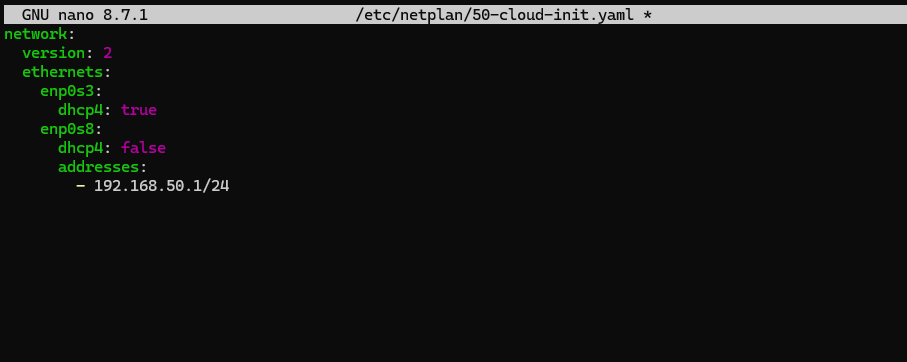
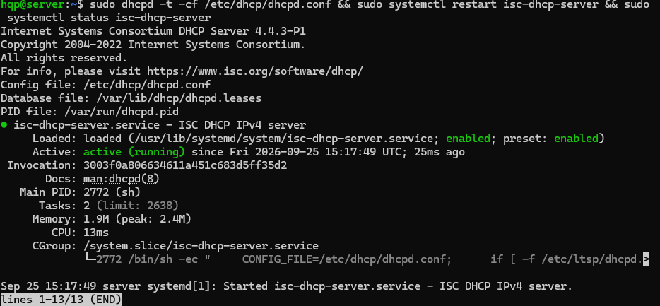
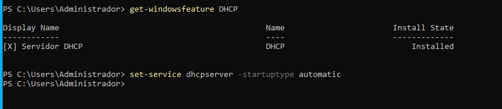
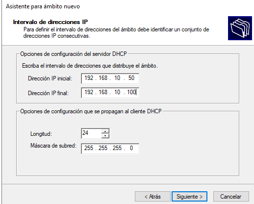
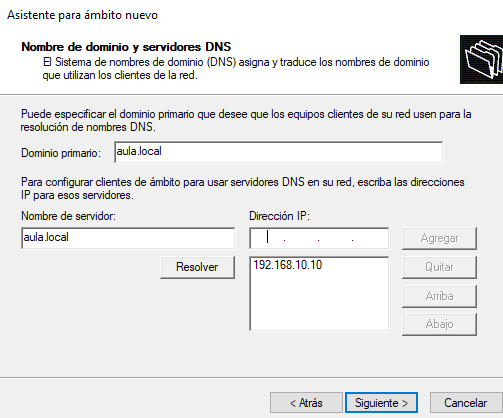
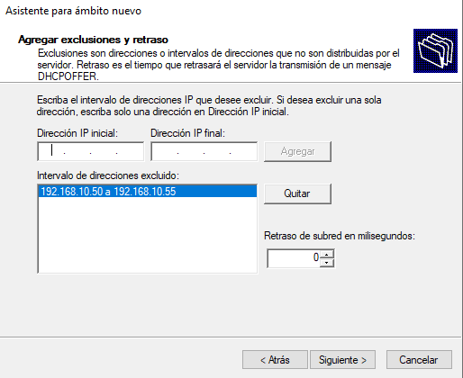

# Servidor DHCP en Linux y en Windows Server

Implantación de un servicio **DHCP** en dos plataformas: **isc-dhcp-server** sobre Ubuntu Server y el rol **Servidor DHCP** de Windows Server, con ámbito, exclusiones y opciones de red. Todo en máquinas virtuales de VirtualBox con red interna.

Prácticas de *Administración de Sistemas Operativos* (2º ASIR).

## 1. Ubuntu Server con isc-dhcp-server

```
[Ubuntu Server] ── red interna "intnet" ── [Ubuntu Client]
 enp0s8: 192.168.50.1/24 (fija)             enp0s3: DHCP
```

| Archivo | Para qué |
|---|---|
| [`linux/50-cloud-init.yaml`](linux/50-cloud-init.yaml) | IP fija en la interfaz de la red interna |
| [`linux/isc-dhcp-server`](linux/isc-dhcp-server) | Interfaz en la que escucha el servicio |
| [`linux/dhcpd.conf`](linux/dhcpd.conf) | Subred, rango `192.168.50.10-100`, puerta de enlace, DNS y tiempos de concesión |

```bash
sudo apt install isc-dhcp-server
sudo netplan apply
sudo dhcpd -t -cf /etc/dhcp/dhcpd.conf          # validar la sintaxis antes de reiniciar
sudo systemctl restart isc-dhcp-server
sudo systemctl enable isc-dhcp-server
sudo systemctl status isc-dhcp-server
cat /var/lib/dhcp/dhcpd.leases                  # concesiones entregadas
```

| | |
|---|---|
|  |  |
| IP fija del servidor | Configuración validada y servicio activo |

## 2. Windows Server con el rol DHCP

| Parámetro | Valor |
|---|---|
| Red | 192.168.10.0/24 |
| Rango del ámbito | 192.168.10.50 – 192.168.10.100 |
| Exclusión | 192.168.10.50 – 192.168.10.55 |
| Dominio / DNS | `aula.local` / 192.168.10.10 |

Instalación desde el Administrador del servidor y comprobación con PowerShell:

```powershell
Get-WindowsFeature DHCP
Set-Service DHCPServer -StartupType Automatic
Get-DhcpServerv4Scope
Get-DhcpServerv4ExclusionRange -ScopeId 192.168.10.0
Get-DhcpServerv4OptionValue -ScopeId 192.168.10.0
Get-DhcpServerv4Lease -ScopeId 192.168.10.0
```

| | |
|---|---|
|  |  |
| Rol DHCP instalado | Rango del ámbito |
|  |  |
| Opciones de dominio y DNS | Rango excluido |

## Comparativa

| | Linux (isc-dhcp-server) | Windows Server |
|---|---|---|
| Configuración | Archivo de texto `dhcpd.conf` | Consola DHCP o PowerShell |
| Validación | `dhcpd -t` | Asistente y cmdlets `Get-DhcpServer*` |
| Concesiones | `/var/lib/dhcp/dhcpd.leases` | `Get-DhcpServerv4Lease` |
| Integración con AD | No | Autorización del servidor en el dominio |

El proceso que siguen cliente y servidor en ambos casos es el mismo (**DORA**: Discover, Offer, Request, Acknowledge).
